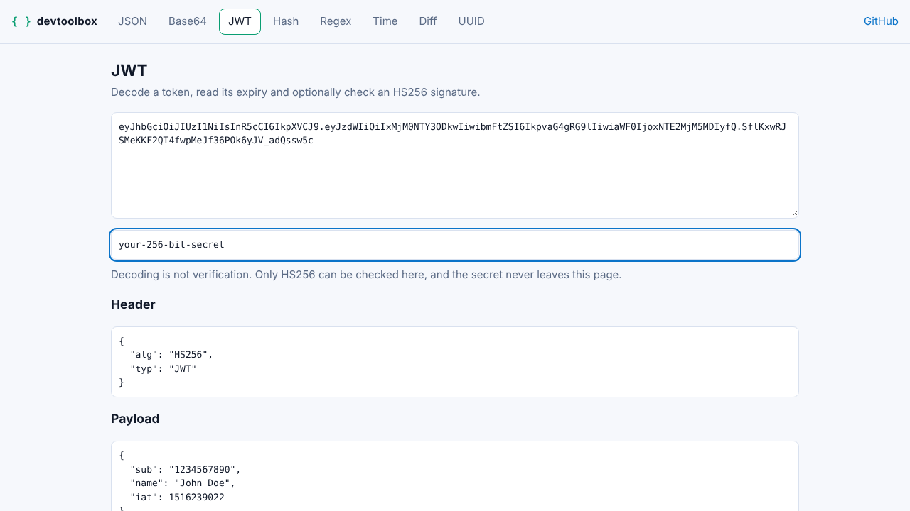

# devtoolbox

Eight small developer utilities in one page. No build step, no dependencies, and nothing is uploaded: everything runs in your browser.

**Live:** https://lasmeldas.github.io/devtoolbox/



| Tool | What it does |
| --- | --- |
| JSON | Format or minify, sort keys, and get the exact line and column of a syntax error |
| Base64 | Encode and decode text (Unicode safe), standard or URL-safe alphabet |
| JWT | Decode a token, read `exp`/`nbf`/`iat` in plain words, check an HS256 signature |
| Hash | MD5, SHA-1, SHA-256, SHA-384, SHA-512 |
| Regex | Live matches, numbered and named groups, highlighting |
| Time | Epoch seconds/ms/µs/ns or an ISO date, shown in UTC, local time and relative |
| Diff | Line diff of two texts |
| UUID | Generate v4 and time-ordered v7, or inspect any UUID |

## Design

- The logic lives in `src/lib/*.js` as plain functions that return `{ ok, ... }` or `{ ok: false, error }`. They never touch the page, so Node can test them directly.
- `src/app.js` is only the interface on top of those functions.
- MD5 is implemented in JavaScript (the Web Crypto API does not offer it) and is checked against the RFC 1321 vectors and against Node's own hash for every input length up to 300.
- JWT signatures and the other hashes use Web Crypto. Only HS256 is verified, and the page says so for other algorithms instead of pretending.

## Run and test

```bash
npm start      # serves the folder at http://localhost:8000
npm test       # node --test, 69 tests, needs Node 20 or newer
```

Tests compare results with Node's `crypto` and `Buffer` where possible, so the code is checked against an independent implementation rather than against itself. CI runs on Node 20 and 22.

## License

MIT. Built by [Beamlak](https://github.com/lasmeldas).
